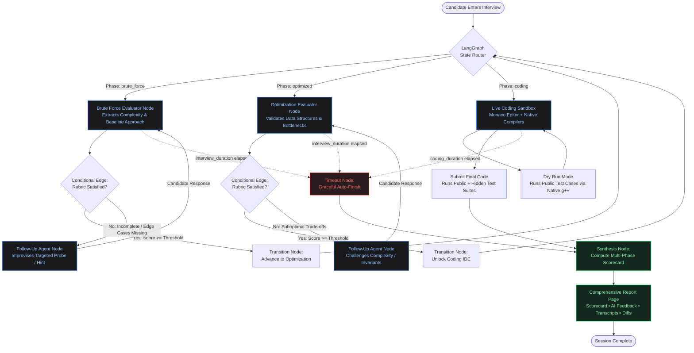

# CodeVue — Full-Stack Agentic AI Technical Interview & Code Execution Platform
🌐 Live Platform:https://codevue-frontend.onrender.com

CodeVue is a full-stack, production-ready **Agentic AI platform** engineered to simulate the conversational depth and algorithmic rigor of FAANG/Tier-1 software engineering interviews.

While platforms like LeetCode host extensive question lists (e.g., the Top 150 Interview Study Plan), they function strictly as static unit-test runners. In real technical interviews, engineers rarely fail because of simple syntax or basic math; **they fail because they cannot articulate their thoughts under pressure, code in complete silence, and fail to adapt when an interviewer challenges their approach.**

CodeVue solves this by orchestrating an **adaptive, cyclic AI Interviewer Agent powered by LangGraph**. The agent actively improvises responses, detects gaps in a candidate's reasoning, generates targeted follow-up probes, and enforces a strict 3-phase technical state machine before granting access to a live, sandboxed code editor.

---


## 🧠 Why Agentic AI with LangGraph?

Standard LLM wrappers and linear prompt chains fail in technical interviews. If a candidate gives an incomplete brute-force explanation, a linear pipeline either blindly accepts it or produces generic feedback.

Real technical interviews require **stateful, cyclic reasoning**:
* **Autonomous State Evaluation**: The agent evaluates understanding against strict rubric criteria (time/space complexity, constraints, and edge cases).
* **Dynamic Improvisation & Follow-up Loops**: If the explanation is incomplete, the agent does not advance. Instead, it transitions to a follow-up node that improvises adaptive hints or asks probing questions based on the candidate's exact wording.
* **Conditional Edge Routing**: Transitions are governed by LangGraph conditional edges that inspect rubric scores and remaining time allowances to determine whether to loop, advance, or terminate.
* **Persistent Checkpointing**: The full conversational history, phase scores, and agent scratchpad are atomically committed to MongoDB after every turn.

---


## 🤖 LangGraph Agent State Machine & Workflow

The interview flow is orchestrated as a stateful cyclic directed graph (`StateGraph`):



---


## ⚡ Key Architectural Features

### 1. LangGraph-Driven Multi-Turn Orchestration
- **Adaptive Questioning**: Rather than relying on a static prompt, the agent examines the candidate's answers against problem constraints, identifying missing edge cases and formulating custom follow-up probes.
- **Dynamic Phase Transitions**: Strict conditional guards prevent candidates from jumping to code until their verbal reasoning passes the evaluation threshold.

### 2. Hybrid Authentication Architecture
- **Custom JWT Authentication**: Secure password hashing with PBKDF2/HMAC and custom token verification for standard email/password registrations.
- **Google OAuth 2.0 Integration**: One-click Google Sign-In for streamlined onboarding.
- **Unified Identity**: All interview sessions, code submissions, and performance metrics map to the user's canonical email identity regardless of sign-in provider.

### 3. Dual-Timer State Machine Lifecycle
To mirror real technical interviews, CodeVue separates the session into two independent clocks:
- **`interview_duration` (Discussion Clock)**: Enforces pacing across the Brute Force and Optimization discussion phases. If a candidate stalls or fails to defend their ideas within the limit, the session terminates cleanly.
- **`coding_duration` (Live Coding Clock)**: A dedicated countdown timer that activates only when the candidate successfully defends their approach and unlocks the editor.

### 4. Native Multi-Language Subprocess Execution Engine
- **Direct Host Execution (Zero-Docker Overhead)**: Executes user code locally using host compilers and runtimes, eliminating container latency:
  - **C++ (C++17 via GCC / `g++`)**: Compiled directly with `-O2` optimization and executed natively.
  - **Python (Python 3.10+)**: Executed directly within the active environment.
  - **Java (OpenJDK 17 `javac` & `java`)**: Compiled and executed via classpath sandboxing.
- **Automated Harness Injection**: Wraps user-submitted solutions inside custom test-harness templates, executing test cases in memory and returning structured JSON outputs using delimiter markers (`__CODEVUE_RESULTS_START__`).
- **Process Isolation & Resource Guarding**: Built using Python's `subprocess` and `tempfile` modules with strict timeout handling (Time Limit Exceeded protection) and automated directory teardown to prevent orphaned binaries.

### 5. Split Test-Suite Architecture
- **Public Test Cases**: Visible in the candidate's Monaco workspace for debugging and dry runs (`POST /interviews/{id}/run`).
- **Hidden Test Cases**: Evaluated only upon final submission (`POST /interviews/{id}/code`) to test boundary conditions, extreme constraints, negative values, and stress inputs.

### 6. Candidate Analytics & Progress Suite
- **11 Topic Tracks**: Practice across Array/String, Sliding Window, Two Pointers, Linked Lists, Stacks, Trees, DP, Graphs, Backtracking, Greedy, and Number Theory.
- **Mastery Analytics**: Track phase performance (Brute Force / 10, Optimization / 10, Code Execution / 10) and curriculum completion rates.
- **Dedicated Scorecard & Review (`/interview/:id/report`)**: Review past sessions with composite candidate ratings (*Strong Hire*, *Hire*, *Lean Hire*, *Needs Practice*), side-by-side transcripts of user explanations vs. AI feedback, and syntax-highlighted code submissions.

---

## 🛠️ Tech Stack

```text
                     ┌──────────────────────────────────────────────┐
                     │            React (Vite) Frontend             │
                     │ Monaco Editor | React Router | Lucide Icons │
                     └──────────────────────┬───────────────────────┘
                                            │ HTTP / JSON API
                                            ▼
                     ┌──────────────────────────────────────────────┐
                     │           FastAPI Backend Service            │
                     │   LangGraph Agent | Phase Router | State     │
                     └───────┬──────────────────────────────┬───────┘
                             │                              │
              Optimistic     │                              │ Native Subprocess
             State Updates   ▼                              ▼
          ┌──────────────────────┐             ┌─────────────────────────┐
          │     MongoDB Atlas    │             │ Native Execution Engine │
          │ Versioned Interviews │             │ Host Compilers          │
          │ User Progress Logs   │             │ (GCC g++, Python, Java) │
          └──────────────────────┘             └─────────────────────────┘
```

| Layer | Technologies |
| :--- | :--- |
| **Agentic AI & Orchestration** | **LangGraph**, **LangChain Core**, Groq / LLaMA-3 (Evaluator & Follow-up Nodes) |
| **Frontend** | React 18, Vite, Monaco Editor (`@monaco-editor/react`), Lucide React, React Router v6 |
| **Backend** | FastAPI, Python 3.10+, Pydantic v2, Uvicorn, HTTPX |
| **Database** | MongoDB Atlas, Motor / PyMongo (Optimistic concurrency control via `$inc: { version: 1 }`) |
| **Code Execution Engine** | Native Host Sandboxing (`g++` C++17, Python 3.10+, `javac`/`java` OpenJDK 17) via `tempfile` & `subprocess` |
| **Authentication** | Custom JWT (PBKDF2/HMAC) + Google OAuth 2.0 |
| **Styling** | Custom Responsive CSS (Dark Theme: `#121316` background, `#ef4444` accent) |

---


## 📁 Repository Structure

```text
CodeVue/
├── ai-service/                   # FastAPI Backend & Agent Service
│   ├── app/
│   │   ├── agent/                # LangGraph Agentic Workflows
│   │   │   ├── state.py          # Agent state schema & interview context
│   │   │   ├── nodes.py          # Evaluator, follow-up probe & synthesis nodes
│   │   │   └── graph.py          # StateGraph compilation & conditional routing edges
│   │   ├── data/
│   │   │   └── questions_bank.py # 31+ problems with starter code, public & hidden tests
│   │   ├── db/
│   │   │   └── mongodb.py        # MongoDB connection client & collections
│   │   ├── routes/
│   │   │   ├── interview.py      # State machine endpoints & code execution routes
│   │   │   └── auth.py           # JWT generation, Google OAuth verification
│   │   ├── services/
│   │   │   ├── code_executor.py  # Language test harnesses & local GCC/subprocess runners
│   │   │   └── interview_store.py# Atomic versioned persistence in MongoDB
│   │   └── main.py               # FastAPI entrypoint & CORS middleware
│   ├── .env.example              # Environment variables template
│   └── requirements.txt          # Python dependencies
│
├── frontend/                     # React + Vite Web Client
│   ├── src/
│   │   ├── context/
│   │   │   └── AuthContext.jsx   # Auth state (Custom JWT + Google OAuth)
│   │   ├── pages/
│   │   │   ├── Dashboard.jsx     # Topic tracks & launchpad
│   │   │   ├── InterviewWorkspace.jsx # Split IDE, AI chat, live console, phase stepper
│   │   │   ├── MockInterviews.jsx# Filterable interview history log & scorecard links
│   │   │   ├── Progress.jsx      # Phase performance & curriculum coverage metrics
│   │   │   ├── Profile.jsx       # User preferences & default editor language
│   │   │   └── InterviewReport.jsx # Post-interview scorecard & AI review transcripts
│   │   ├── App.jsx               # Client routes & ProtectedRoute wrappers
│   │   └── index.css             # Theme variables & base styling
│   ├── package.json
│   └── vite.config.js
└── README.md
```

---


## 🚀 Getting Started

### Prerequisites

Make sure the following tools are installed on your host system:
* **Node.js**: v18+ and `npm`
* **Python**: v3.10+
* **Host Compilers & Runtimes**:
  * **GCC / `g++`** (MinGW-w64 on Windows or GCC on Linux/macOS) added to system `PATH`
  * **Java (OpenJDK 17+)** (`javac` and `java` in system `PATH`)
  * **Python** in system `PATH`
* **MongoDB**: A MongoDB Atlas connection URI or local MongoDB instance

---

### Backend Setup (`ai-service`)

1. Navigate to the `ai-service` directory:
   ```bash
   cd ai-service
   ```

2. Create and activate a Python virtual environment:
   ```bash
   # Windows (PowerShell)
   python -m venv .venv
   .venv\Scripts\Activate.ps1

   # Linux / macOS
   python3 -m venv .venv
   source .venv/bin/activate
   ```

3. Install backend dependencies (including LangGraph and LangChain):
   ```bash
   pip install -r requirements.txt
   ```

4. Configure environment variables:
   Create a `.env` file inside `ai-service/` (or copy from `.env.example`):
   ```env
   INTERVIEW_MONGO_URI=mongodb+srv://<username>:<password>@cluster.mongodb.net/codevue?retryWrites=true&w=majority
   GROQ_API_KEY=your_groq_or_llm_api_key
   JWT_SECRET=your_jwt_secret_key
   ```

5. Start the backend service:
   ```bash
   uvicorn app.main:app --reload --port 8000
   ```
   The API will be available at `http://localhost:8000`. Interactive documentation can be viewed at `http://localhost:8000/docs`.

---

### Frontend Setup (`frontend`)

1. Open a new terminal and navigate to the frontend directory:
   ```bash
   cd frontend
   ```

2. Install dependencies:
   ```bash
   npm install
   ```

3. Configure environment variables:
   Create a `.env` file inside `frontend/`:
   ```env
   VITE_AI_SERVICE_URL=http://localhost:8000
   ```

4. Launch the development server:
   ```bash
   npm run dev
   ```
   Open your browser to `http://localhost:5173`.

---

## 📡 API Reference

| Method | Endpoint | Description |
| :--- | :--- | :--- |
| `POST` | `/interviews/start` | Starts an interview session, initializes the LangGraph state, and sets timers. |
| `GET` | `/interviews/{id}` | Fetches current interview status, active phase, and deadlines. |
| `POST` | `/interviews/{id}/answer` | Evaluates candidate explanations through LangGraph evaluator/follow-up nodes. |
| `POST` | `/interviews/{id}/run` | Dry-runs candidate code strictly against **public test cases** via local `g++`/compiler subprocesses. |
| `POST` | `/interviews/{id}/code` | Submits code for final grading against **public + hidden test cases**. |
| `GET` | `/interviews/{id}/report` | Retrieves the post-interview evaluation report, scorecard, and diffs. |
| `GET` | `/interviews/user/{email}/history` | Aggregates user interview attempts, completions, and phase score averages. |

---


## 🔒 Concurrency & Reliability

CodeVue utilizes **optimistic concurrency control** in MongoDB to avoid race conditions during candidate polling and code submissions:
* Every interview document maintains a sequential integer `version` field.
* Updates use atomic conditional queries:
  ```python
  interviews_collection.update_one(
      {"interview_id": interview_id, "version": current_version},
      {"$set": update_fields, "$inc": {"version": 1}}
  )
  ```
* If a write conflict occurs while a background deadline check or client request updates the document, the update is safely aborted, preventing dirty writes and inconsistent state.
